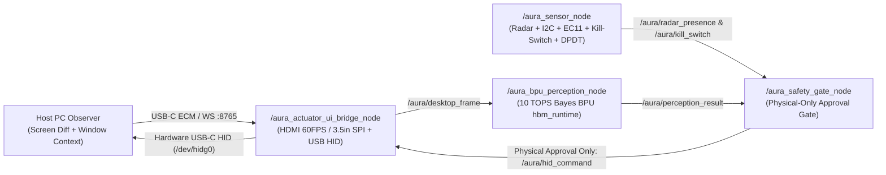

# AURA-X5: Embodied Proactive Desktop AI Co-Pilot

- **Participant:** 147qaz258-ead
- **Stage completed:** 2
- **Repository:** https://github.com/147qaz258-ead/AURA-X5
- **Demo video:** Stage 2 is a design stage; the 3–7 minute 1080p demo video comes with Stage 3. Complete Stage 2 design documents, KiCad PCB (0 DRC errors), 3D enclosure STLs, and ROS 2 package are linked below.
- **Community post:** https://discord.com/channels/1300358874280230994/1569684675004334110
- **License:** MIT

## Summary

AURA-X5 is a desktop embodied proactive AI co-pilot powered by the **D-Robotics RDK X5 (10 TOPS BPU)**, designed for developers and engineers who want continuous workspace assistance without sacrificing host compute, focus, or hardware privacy. Software-only desktop agents consume host GPU/CPU for vision, disrupt workflow with pop-ups, and inject simulated keystrokes without a physical emergency stop. AURA-X5 moves visual perception, multi-sensor presence detection, and safety gating onto an external 15-degree desktop console tethered to the workstation over USB-C and ROS 2. On the host side, a validated 12 FPS screen-change observer filters idle frames and streams compact desktop context to the RDK X5. On the board, a four-node ROS 2 graph coordinates continuous `hbm_runtime` BPU inference, desk presence and environmental telemetry (HLK-LD2410C mmWave radar, SHT40, VL53L1X, INA219), a non-intrusive secondary display (60 FPS HDMI kiosk UI or 3.5-inch SPI touchscreen), and a strict hardware safety gate. Crucially, no USB-C HID keyboard/mouse macro can execute without explicit physical confirmation via the EC11 rotary encoder or local panel, a dedicated Kill-Switch aborts active queues and releases all HID keys in under 50 ms, and a DPDT toggle physically severs the 3.3V power rail to the microphone and camera. We deliver both a DRC-clean custom KiCad carrier HAT with watertight 3D-printed enclosure files and a solderless HDMI + DuPont build path for rapid community replication.

## Technical Highlights

- **RDK board / image:** D-Robotics RDK X5 (Linux 6.1.83, Ubuntu 22.04 official RDK OS, TogetherROS / ROS 2 Humble).
- **AI model and runtime:** `hbm_runtime 1.24.5` (HBRT `3.15.55.0`) executing quantized INT8 `.bin`/`.hbm` models (`mobilenetv2_224x224_nv12.bin`, extensible to YOLOv8 / tiled 640×640 PP-OCRv5) on the 10 TOPS Bayes BPU with strict fail-fast enforcement (zero silent CPU fallback).
- **Sensors and actuators:** HLK-LD2410C 24 GHz mmWave presence radar (UART `/dev/ttyS1`), SHT40 / VL53L1X / INA219 (I2C-5), EC11 rotary encoder, hardware Kill-Switch (GPIO Pin 7), DPDT hardware privacy switch (`V_PRIVACY_3V3` + Pin 29 sense), USB-C OTG Composite Gadget (`/dev/hidg0` keyboard + `/dev/hidg1` mouse), 60 FPS HDMI UI / 3.5" ILI9486+XPT2046 SPI touchscreen, WS2812B RGB status ring, and 5V PWM cooling fan.
- **ROS 2 design:** Four-node ROS 2 Humble package (`aura_x5_ros`: `aura_sensor_node`, `aura_bpu_perception_node`, `aura_safety_gate_node`, `aura_actuator_ui_bridge_node`) with unified launch (`aura_x5.launch.py`), typed JSON/Bool topics, `/aura/reset_kill_latch` recovery service, and timestamp-synchronized multi-sensor correlation.
- **BPU evidence and performance:** Pre-verified `hbm_runtime` BPU bring-up script (`scripts/test_bpu_on_rdk.py`), host 12.00 FPS / 0.00% drop 20-minute capture baseline, 90-line controlled 4K OCR tiling study for 640×640 BPU input, DRC=0 custom PCB (`electronics/validation.json`), and automated ≥35s continuous concurrent BPU benchmark harness (`scripts/benchmark_bpu_concurrent.py`) prepared for Stage 3 measurement.

## Architecture

Full module responsibilities, failure modes, compute allocation, and ROS 2 topic/service rates are documented in [docs/ARCHITECTURE.md](https://github.com/147qaz258-ead/AURA-X5/blob/main/docs/ARCHITECTURE.md).

## Links and Evidence

- Stage 2 Proposal (concept, users, innovation, measurable targets): https://github.com/147qaz258-ead/AURA-X5/blob/main/docs/PROPOSAL.md
- Stage 2 Architecture (data-flow, modules, compute plan, ROS 2 graph): https://github.com/147qaz258-ead/AURA-X5/blob/main/docs/ARCHITECTURE.md
- Stage 2 Engineering Plan (full BOM, schedule, top-5 risks, repo layout): https://github.com/147qaz258-ead/AURA-X5/blob/main/docs/ENGINEERING_PLAN.md
- Public Project Roadmap: https://github.com/147qaz258-ead/AURA-X5/blob/main/ROADMAP.md
- ROS 2 Package (`aura_x5_ros` + launch + params): https://github.com/147qaz258-ead/AURA-X5/tree/main/ros2_ws/src/aura_x5_ros
- Stage 1 Ignite Report (bring-up & rolling evidence): https://github.com/147qaz258-ead/AURA-X5/blob/main/docs/STAGE1_IGNITE.md
- Stage 3 Benchmarks & Safety Manual: https://github.com/147qaz258-ead/AURA-X5/blob/main/docs/BENCHMARKS_AND_SAFETY.md
- Custom KiCad PCB (0 DRC errors, Gerber & BOM) + Watertight 3D STLs: https://github.com/147qaz258-ead/AURA-X5/tree/main/electronics

## Known Limitations and Safety

- **Actuator Safety:** Because AURA-X5 injects real USB-C HID keyboard/mouse events via `/dev/hidg0`, all automated software/remote approval paths are rejected (`PermissionError`). Only explicit local physical confirmation triggers actuation, and pressing the hardware Kill-Switch (`GPIO Pin 7`) latches the safety gate, aborts all pending macros, and immediately writes an 8-byte all-zero HID release packet (`0x00 * 8`) to prevent stuck modifier keys.
- **Privacy Guarantee:** Flipping the front-panel DPDT switch physically disconnects the 3.3V supply (`V_PRIVACY_3V3`) to the microphone/camera rail independently of OS or software state.
- **Rolling Schedule Note:** Stage 1 live board capture screenshots and Stage 3 continuous ≥30s concurrent BPU benchmarks + 8-step physical HIL logs (`verification/physical_test_plan.csv`) will be added to the repository and linked in the Stage 3 update of this showcase file before December 15, 2026.

---

I agree that this showcase document may be used by the Robotics Dream Keeper Challenge organizers for program promotion, judging, and archives as described in the official README.
