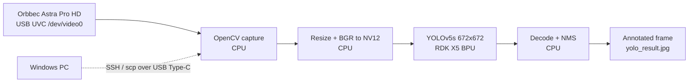

# Service Robot Kit for Autonomous Navigation on RDK X5

- **Participant:** Apiluck Noppkun (Bruce) · [@banh0001](https://github.com/banh0001)
- **Stage completed:** 1
- **Repository:** https://github.com/banh0001/RDK-Dream-Keeper-Winter-2026-APILUCK-NOPPKUN
- **Demo video:** Stage 1 evidence (screenshots): https://github.com/banh0001/RDK-Dream-Keeper-Winter-2026-APILUCK-NOPPKUN/blob/main/stage1-ignite/images/C_yolo.png — video planned for Stage 3
- **Community post:** https://discord.com/channels/1300358874280230994/1563152274644144208
- **License:** MIT

## Summary

This project aims to build a service robot kit for autonomous indoor navigation: a robot that can be
told "go to the chair" and find it on its own. It will build a LiDAR map, label the objects it sees
with an on-device detector, and navigate to them by name. Stage 1 lays the foundation on a D-Robotics RDK X5.

I flashed RDK OS 3.5.0 (desktop) to a microSD card with the RDK Studio Flasher, connected the board
to my Windows PC over the USB Type-C QuickLink port and to the internet over Wi-Fi, and logged in
over SSH from PowerShell (`ping google.com` with 0 % loss, `uname -a`, `htop`). For the sensor
challenge I used an Orbbec Astra Pro HD camera over USB (UVC, `/dev/video0`) and captured
1280×720 frames with OpenCV.

For the first AI task I ran YOLOv5s object detection on the BPU with the live Astra feed. The
official USB-camera demo opens a full-screen window, which fails over SSH, so I made a headless copy
that writes each annotated frame to a file instead of displaying it. The model loads on BPU core 0
and detects a person in the live frame. Logs, images, commands and a troubleshooting table are in
the repository.

## Technical Highlights

- **RDK board / image:** RDK X5 · `rdk-x5-ubuntu22-preinstalled-desktop-3.5.0-arm64` (Ubuntu 22.04, kernel 6.1.83 aarch64), flashed with RDK Studio Flasher
- **AI model and runtime:** `yolov5s_v2_672x672_bayese_nv12` (COCO, 80 classes, NV12 input) · `hbm_runtime` · BPU Platform 1.3.6 · DNN runtime 1.24.5 (HBRT 3.15.55)
- **Sensors and actuators:** Orbbec Astra Pro HD RGB stream over USB UVC `/dev/video0` (MJPG 1280×720); no actuators in Stage 1
- **ROS 2 design:** not used in Stage 1; planned for Stage 2–3 (LiDAR + `slam_toolbox` + Nav2 + YOLO detection node)
- **BPU evidence and performance:** model loaded with `bpu_cores: [0]`; live detection `person 0.41` saved to `yolo_result.jpg`. FPS and latency not yet measured — planned for Stage 2.

## Architecture

Frames are captured and pre-processed on the CPU, inference runs on the BPU, and post-processing
draws the boxes. The run is started over SSH, and results are copied back to the PC with `scp`.

## Links and Evidence

- Stage evidence:
  - Screenshot A — Flash → Wi-Fi → SSH: https://github.com/banh0001/RDK-Dream-Keeper-Winter-2026-APILUCK-NOPPKUN/blob/main/stage1-ignite/images/A_flash_ssh.png
  - Screenshot B — Camera over USB: https://github.com/banh0001/RDK-Dream-Keeper-Winter-2026-APILUCK-NOPPKUN/blob/main/stage1-ignite/images/B_camera.png
  - Screenshot C — YOLO on the BPU: https://github.com/banh0001/RDK-Dream-Keeper-Winter-2026-APILUCK-NOPPKUN/blob/main/stage1-ignite/images/C_yolo.png
  - Logs and raw images: https://github.com/banh0001/RDK-Dream-Keeper-Winter-2026-APILUCK-NOPPKUN/tree/main/stage1-ignite/evidence
- Benchmarks: not yet measured (planned for Stage 2)
- Documentation: https://github.com/banh0001/RDK-Dream-Keeper-Winter-2026-APILUCK-NOPPKUN/blob/main/stage1-ignite/README.md

## Known Limitations and Safety

- Stage 1 is perception only; the robot does not move yet, so there are no motion safety risks at this stage.
- The YOLO result is a single saved frame with moderate confidence (0.41); throughput has not been benchmarked.
- The runtime prints a version-mismatch warning between HBRT 3.15.55 and the model build 3.15.47; detection still works.
- The headless script is a local modification of the D-Robotics sample (Apache-2.0). It is documented as a `sed` patch and not redistributed.
- Evidence images show the participant's face, shared with consent. No Wi-Fi credentials, tokens or device serials are published.

---

I agree that this showcase document may be used by the Robotics Dream Keeper Challenge organizers for program promotion, judging, and archives as described in the official README.
