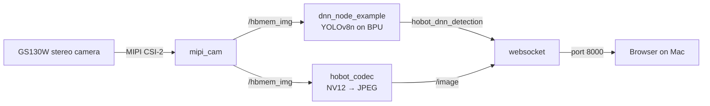

# SpotMicro-Plant: Crop-Inspecting Quadruped

- **Participant:** Ayesha Qureshi
- **Stage completed:** 1
- **Repository:** https://github.com/ayeshaq27/SpotMicro-Plant
- **Demo video:** https://github.com/ayeshaq27/SpotMicro-Plant/tree/main/stage1/evidence
- **Community post:** [Stage 1 update on Discord](https://discord.com/channels/1300358874280230994/1562841654505898034/1569480691559694438)
- **License:** MIT

## Summary

I'm building a robot dog for farmers in Sindh, Pakistan. Many smallholder farms there grow several crops side by side, and a diseased plant or a pest outbreak can spread before anyone catches it. My goal is a low-cost SpotMicro quadruped that walks between the rows, looks at the plants with a stereo camera, and tells the farmer what it found as a voice message in their own language, using Uplift AI's Pakistani-language voice technology.

Stage 1 was about giving the dog a brain. This was my first time flashing a board, and I learn best by building, so a lot of this stage was figuring things out as they broke. I flashed RDKOS 3.5.0 with RDK Studio, got the X5 online, and SSH'd in from my Mac. Then I brought up the RDK Stereo Camera GS130W over MIPI with the `mipi_cam` ROS 2 node, and ran YOLOv8n on the BPU straight from the live feed. Seeing the first "laptop" box pop up in my browser was the moment it all felt real.

Most of my time went into debugging. The camera kept failing with "capture init failure" until I realized the ribbon cables were in upside down: the GS130W wants its contacts facing away from the camera's board, the opposite of its sibling, the GS130WI. The YOLO demo then crashed with a VSE error until I dropped the resolution to 640×480. And when RDK Studio couldn't set up the USB connection, I configured my Mac's network adapter by hand. It's all written up in my repo so the next person can skip the headaches.

Next up: a model that recognizes crops instead of laptops, and teaching the dog to walk.

## Technical Highlights

- **RDK board / image:** RDK X5 (8GB), RDKOS 3.5.0, TogetheROS (ROS 2 Humble), `tros-humble-mipi-cam` 2.5.2
- **AI model and runtime:** YOLOv8n (`yolov8_640x640_nv12.bin`, pretrained on COCO, 80 classes), run with `dnn_node_example` on the BPU
- **Sensors and actuators:** RDK Stereo Camera GS130W (dual SC132GS global-shutter sensors, 1280×1088 per camera) over MIPI CSI-2. No actuators yet; DS3225 servos and a PCA9685 driver are planned for Stage 2.
- **ROS 2 design:** `mipi_cam` publishes frames over shared memory (`/hbmem_img`). `dnn_node_example` subscribes, runs YOLOv8n on the BPU, and publishes detections on `hobot_dnn_detection`. `hobot_codec` encodes frames to JPEG (`/image`), and `websocket` combines the images and detections for the browser view.
- **BPU evidence and performance:** On the web display during the YOLO run, the camera reported 60 fps, with an AI delay of roughly 2.2 s (`ai_delay_0: 2196`, likely milliseconds) and a board temperature of 66.5°C. The delay is far higher than the model's published inference speed, so reducing it (thermal management, pipeline settings) is a known follow-up.

## Architecture

The camera node shares frames with both the inference node and the JPEG encoder through shared memory. The websocket node overlays detections on the encoded frames and serves the result to a browser on the same network.

## Links and Evidence

- Stage evidence: [stage1/evidence](https://github.com/ayeshaq27/SpotMicro-Plant/tree/main/stage1/evidence) (flash + SSH, stereo camera feed, YOLO detection)
- Benchmarks: see the BPU performance notes above
- Documentation: [README](https://github.com/ayeshaq27/SpotMicro-Plant/blob/main/README.md) (setup, commands, dependencies, troubleshooting) and [stereo camera bring-up notes](https://github.com/ayeshaq27/SpotMicro-Plant/blob/main/docs/camera-setup.md)

## Known Limitations and Safety

- **It only knows laptops, not leaves (yet).** YOLOv8n is pretrained on COCO, so it can't spot crops, diseases, or pests. Training a custom model is next.
- **It's a bit slow to react.** Detections lag the camera by about 2 seconds, which is fine on a desk but not on a walking robot.
- **One eye for now.** YOLO uses a single camera from the stereo pair, so depth isn't being used yet.
- **The view is sideways** in dual-camera mode, because of how the camera sat during testing. It'll be fixed once it's mounted.
- **No moving parts yet**, so no motion safety concerns in Stage 1. Later stages bring a 2S LiPo and high-torque servos, which will need power isolation and an emergency stop.
- A bystander's face in the YOLO screenshot is blurred. No Wi-Fi passwords, tokens, or device serials are published.

---

I agree that this showcase document may be used by the Robotics Dream Keeper Challenge organizers for program promotion, judging, and archives as described in the official README.
