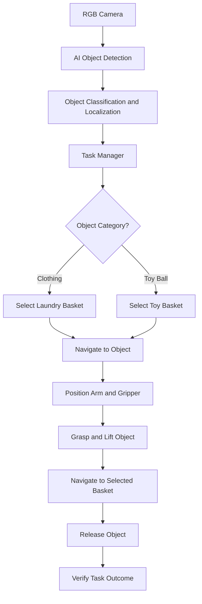

# RDK X5 Autonomous Room Organizer

**Participant:** Bheesha  
**GitHub Username:** bheesha  
**Challenge:** Robotics Dream Keeper Winter 2026  
**Current Stage:** Stage 2: Build Challenge  
**Development Board:** D-Robotics RDK X5  
**Project Repository:** https://github.com/bheesha/RDK-X5-Room-Organizer  
**License:** No open-source license (All rights reserved)

## 1. Project Summary

The RDK X5 Autonomous Room Organizer is an intelligent mobile robotics project designed to help organize cluttered indoor spaces by identifying, collecting, and sorting misplaced household objects.

The initial prototype will focus on two object categories: lightweight clothing items and small toy balls. The robot will use computer vision to recognize supported objects, autonomous navigation to approach them, and a robotic arm with a gripper to pick them up.

Clothing items will be delivered to a laundry basket, while toy balls will be deposited into a separate storage basket.

The system will use the D-Robotics RDK X5 for edge AI inference and high-level robotic control.

The project aims to demonstrate how perception, decision-making, navigation, and robotic manipulation can work together to complete a practical household organization task.

## 2. Stage 1: Ignite Results

### Challenge 1: Board Bring-Up

**Status: Completed**

- Flashed RDKOS 3.5.0 Desktop (Ubuntu 22.04).
- Successfully booted the RDK X5.
- Established SSH communication from a MacBook using the USB-C network interface.
- Verified the system using `uname -a` and `cat /etc/os-release`.

### Challenge 2: Sensor Explorer

**Status: Completed**

- Interface: GPIO
- Library: Hobot.GPIO
- Connected physical GPIO pins 31 (output) and 37 (input) using a jumper wire.
- Implemented a Python loopback test using alternating HIGH and LOW signals.
- **Result: 4/4 tests passed.**

### Challenge 3: First AI Task

**Status: Completed**

- Task: Image classification
- Model: MobileNetV2
- Execution: RDK X5 BPU, core 0
- Input: Sample image provided with the official demo
- **Result: Zebra detected with 99.36% confidence.**

The inference completed successfully. A model-builder/runtime version warning was observed and documented.

## 3. Stage 2: Build Challenge

**Status: Design and engineering documentation prepared**

### 3.1 Concept and Application

The Autonomous Room Organizer is designed to collect and sort two categories of household objects into separate destinations.

The intended sorting process is:

1. Detect a clothing item or toy ball.
2. Classify the detected object.
3. Estimate its position relative to the robot.
4. Navigate toward the object.
5. Pick it up using a robotic arm and gripper.
6. Select the appropriate basket based on its category.
7. Transport the object to the basket.
8. Release the object and continue searching when appropriate.

The initial environment will be a controlled indoor area with flat flooring, adequate lighting, and two predefined basket locations.

Rolled-up socks and lightweight foam balls will serve as the initial test objects.

The project will prioritize a functioning autonomous sorting system before attempting more complex household environments.

### 3.2 AI System Architecture

The robot will use a modular architecture connecting AI perception, task management, navigation, and robotic manipulation.

The proposed computing allocation is:

- **RDK X5 BPU:** Neural network inference for object detection.
- **RDK X5 CPU:** Image processing, object localization, task management, navigation decisions, and ROS 2 communication.
- **Optional microcontroller:** Low-level motor and servo control.

The ROS 2 design includes modules for camera input, object detection, localization, task management, navigation, arm control, gripper control, and safety monitoring.

Detailed module responsibilities, communication interfaces, expected message rates, and failure handling are documented in the architecture file.

### 3.3 Engineering Roadmap

Development will follow six planned milestones:

| Dates | Milestone |
|---|---|
| November 26 to 27 | System design and engineering planning |
| November 28 to 30 | Hardware assembly and mechanical design |
| December 1 to 3 | Camera integration and object detection |
| December 4 to 7 | Navigation and robotic manipulation |
| December 8 to 11 | Autonomous sorting integration |
| December 12 to 15 | Testing, optimization, and final demonstration |

The minimum demonstration goal is to autonomously sort one supported clothing item and one toy ball into their corresponding baskets.

### 3.4 Measurable Success Targets

| Metric | Proposed Target |
|---|---|
| Object detection success | At least 80% |
| Grasping success | At least 70% |
| Correct basket selection | At least 90% for successfully classified objects |
| End-to-end sorting success | At least 60% |
| Supported object categories | 2 |
| Minimum demonstration | One clothing item and one toy ball sorted correctly |

These are proposed engineering targets and have not yet been experimentally validated.

### 3.5 Innovation and Technical Contribution

The project's technical contribution is the integration of edge AI, autonomous navigation, object-aware decision-making, and robotic manipulation into a single mobile sorting system.

Rather than stopping at object recognition, the robot will use AI detection results to determine which physical actions to perform and where each object belongs.

The initial implementation will focus on reliable end-to-end sorting, with additional attention to grasp verification, task monitoring, and basic failure recovery.

### 3.6 Engineering Risks and Limitations

The main engineering challenges include:

- Reliable grasping of flexible clothing and spherical objects.
- Accurate object localization using camera-based perception.
- Navigation and positioning errors.
- Motor, servo, and electrical power integration.
- Completing system integration within the available development period.

Initial testing will use lightweight objects, fixed basket locations, and a controlled indoor environment.

Manual stopping, safe power distribution, limited movement speeds, and actuator command timeouts are planned.

The full autonomous sorting robot has not yet been built or validated.

## 4. Source Code and Evidence

**Public GitHub Repository:**

https://github.com/bheesha/RDK-X5-Room-Organizer

### Stage 1 Evidence

The project repository includes:

- System flashing evidence.
- SSH connection evidence.
- GPIO test results and Python script.
- MobileNetV2 inference screenshots.
- Project README and technical setup documentation.

### Stage 2 Documentation

- **Project Roadmap:** https://github.com/bheesha/RDK-X5-Room-Organizer/blob/main/ROADMAP.md
- **Project Proposal:** https://github.com/bheesha/RDK-X5-Room-Organizer/blob/main/PROPOSAL.md
- **AI System Architecture:** https://github.com/bheesha/RDK-X5-Room-Organizer/blob/main/ARCHITECTURE.md
- **Engineering Plan:** https://github.com/bheesha/RDK-X5-Room-Organizer/blob/main/ENGINEERING_PLAN.md

## 5. Community Updates

**Stage 1 Discord Post:**

https://discord.com/channels/1300358874280230994/1565929397658058862/1569942246512533604

**Stage 2 Discord Post:**

https://discord.com/channels/1300358874280230994/1565929397658058862/1575696469267324958

## 6. Next Steps: Stage 3

The next stage will focus on implementing and testing the proposed autonomous sorting system.

Planned development activities include:

- Assembling the mobile robotic platform.
- Building and integrating the robotic arm and gripper.
- Configuring camera-based object detection.
- Implementing navigation and object localization.
- Developing object grasping and release operations.
- Integrating perception, navigation, manipulation, and task management.
- Testing autonomous sorting between the laundry and toy baskets.
- Measuring task reliability and documenting results.
- Recording a final robot demonstration.

The final development deadline is December 15, 2026.

## 7. Current Project Status

**Stage 1:** Completed, including board setup, GPIO testing, and initial AI inference.

**Stage 2:** Project concept, technical architecture, engineering roadmap, and implementation plan prepared.

**Stage 3:** Planned. The complete autonomous sorting system has not yet been assembled, integrated, or demonstrated.

## 8. Copyright and Usage

Copyright © 2026 Bheesha. All rights reserved.

The original project code and documentation are not offered under an open-source license. Permission to reproduce, modify, or redistribute these materials must be obtained from the copyright holder, except where permitted by applicable law.

This does not override any applicable permissions granted to the competition organizers for the submitted showcase document.

## 9. Showcase Consent

I agree that this showcase document may be used by the Robotics Dream Keeper Challenge organizers for program promotion, judging, and archives as described in the official challenge README.
