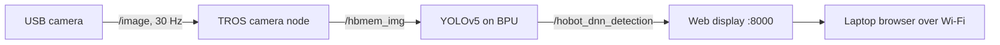

# RDK X5 Autonomous Drone

- **Participant:** ButeraBeni
- **Stage completed:** 1
- **Repository:** <https://github.com/buterabeni-web/rdk-x5-autonomous-drone>
- **Demo video:** <https://github.com/user-attachments/assets/206f594d-c7a0-4acc-b9b2-ef0c5b23fccf>
- **Community post:** <https://discord.com/channels/1300358874280230994/1568536611594174534/1569940832348536994>
- **License:** MIT

## Summary

Drones that support agriculture, mapping, and emergency response often have to fly in hilly or cluttered terrain, where GPS and network connectivity can be unreliable. The goal of this project is an autonomous drone that uses onboard AI and vision on the D-Robotics RDK X5 to perceive its surroundings, navigate, and fly safely without depending on a ground station or cloud service.

Stage 1 established the onboard computing foundation. I flashed RDKOS 3.5.0 Desktop onto a 64 GB microSD card using RDK Studio's in-board flashing over USB-C, without an SD card reader. The board booted, connected to the internet over Wi-Fi, and accepted SSH sessions from my laptop. For sensing, I connected a HBVCAM-W20217 USB camera, verified it with `v4l2-ctl`, and ran it as a ROS 2 node in TogetheROS.Bot (Humble), where it published the `/image` topic at a steady 30 Hz. For the first AI task, I ran YOLOv5 object detection on the BPU with live camera input; it detected a person, a bottle, and a cell phone in real time, with results viewed in a browser.

This camera-to-BPU inference pipeline is the base for the drone's perception system. In the next stages, I will design the full architecture, with the RDK X5 acting as a companion computer to a flight controller, and add vision-based navigation for flying in complex environments.

## Technical Highlights

- **RDK board / image:** RDK X5 (8 GB RAM), RDKOS 3.5.0 Desktop, 64 GB microSD
- **AI model and runtime:** YOLOv5 (pre-trained on COCO, 80 classes) via TogetheROS.Bot `dnn_node_example`
- **Sensors and actuators:** HBVCAM-W20217 V22 USB camera (UVC, MJPG, up to 1280×720 @ 30 fps), used at 640×480
- **ROS 2 design:** USB camera node → `/image` and `/hbmem_img` → BPU YOLO node → `/hobot_dnn_detection` → web visualization on port 8000
- **BPU evidence and performance:** YOLOv5 inference on the BPU with live detections; camera topic `/image` measured at ~30 Hz (std dev ≈ 2 ms) with `ros2 topic hz`

## Architecture

The USB camera streams frames into ROS 2, the BPU runs YOLOv5 on each frame, and the detections are rendered over the video and viewed from a laptop on the same Wi-Fi network.

## Links and Evidence

- Stage evidence: [Stage 1 section of the README](https://github.com/buterabeni-web/rdk-x5-autonomous-drone#stage-1--ignite) (flash, SSH, camera, and YOLO screenshots)
- Benchmarks: camera topic rate ~30 Hz (`ros2 topic hz /image`)
- Documentation: [Repository README](https://github.com/buterabeni-web/rdk-x5-autonomous-drone)

## Known Limitations and Safety

- Stage 1 runs on a desk; no flight hardware is connected yet.
- The pre-trained COCO model is a starting point; the final drone will need models and testing suited to aerial views.
- Future flight tests will follow local drone regulations, use a flight controller with failsafes, and take place in open, safe areas.

---

I agree that this showcase document may be used by the Robotics Dream Keeper Challenge organizers for program promotion, judging, and archives as described in the official README.
