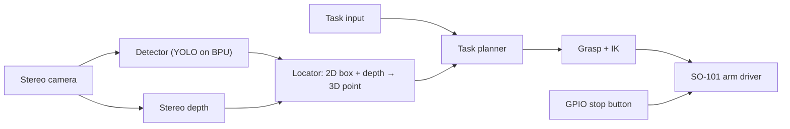

# Elf-101: a Christmas helper robot on RDK X5

- **Participant:** Jonathan Darko Adoo (@adoodevv), Accra, Ghana
- **Stage completed:** 2
- **Repository:** https://github.com/adoodevv/elf101
- **Demo video:** Stage 2 is a design stage; the demo video comes with Stage 3. Design documents are linked below.
- **Community post:** https://discord.com/channels/1300358874280230994/1572201776180887602
- **License:** MIT

## Summary

Elf-101 turns a low-cost SO-101 robot arm into a Christmas helper with the RDK X5 as its only computer. Wrapped gifts and ornaments sit anywhere on a table; you ask for one ("give me the red gift", "put the ornaments in the basket"), and Elf-101 finds it with the RDK stereo camera, works out where it is in 3D, picks it up and delivers it.

Most detection demos stop at boxes on a screen. Here every detection has to end in a physical grasp, so the whole loop has to be fast, accurate in 3D and safe. YOLO runs on the BPU, stereo depth replaces hand-measured table heights, the CPU handles inverse kinematics and servo control, and a GPIO stop button can halt the arm without any software in the way.

The project is also meant for classrooms: I teach robotics at Mikrobot Academy in Ghana, and Elf-101 is built so a school could rebuild it with an open-source arm and a single board, with no cloud or GPU laptop.

Stage 2 result: the proposal, architecture (data flow, module table, compute split, ROS 2 graph) and engineering plan (BOM, risks, roadmap) are published, with measurable targets set before building: at least 15 FPS detection on the BPU, at least 80% pick success over 20 trials, and an emergency stop within 200 ms.

## Technical Highlights

- **RDK board / image:** RDK X5 (sponsored by D-Robotics); official RDK OS image via RDK Studio
- **AI model and runtime:** YOLO from the RDK Model Zoo on the BPU, fine-tuned on photos of the actual props if needed
- **Sensors and actuators:** RDK stereo camera (MIPI CSI); SO-101 arm with 6 Feetech STS3215 servos over USB serial; GPIO emergency-stop button
- **ROS 2 design:** camera, detector, depth, locator, task and arm nodes; pick-and-place as a ROS 2 action; e-stop on its own topic
- **BPU evidence and performance:** targets set in Stage 2 (≥ 15 FPS at 640×640); measured results come in Stage 3

## Architecture

Full details: [ARCHITECTURE.md](https://github.com/adoodevv/elf101/blob/main/docs/ARCHITECTURE.md)

## Links and Evidence

- Stage 2 proposal: https://github.com/adoodevv/elf101/blob/main/docs/PROPOSAL.md
- Architecture: https://github.com/adoodevv/elf101/blob/main/docs/ARCHITECTURE.md
- Engineering plan (BOM, risks, layout): https://github.com/adoodevv/elf101/blob/main/docs/ENGINEERING_PLAN.md
- Roadmap: https://github.com/adoodevv/elf101/blob/main/ROADMAP.md
- Stage 1 evidence (flash, SSH, camera, YOLO on BPU): to be added when the board arrives
- Benchmarks: Stage 3

## Known Limitations and Safety

- The board is being shipped to Ghana, so Stage 1 bring-up follows Stage 2 on the rolling schedule.
- Round ornaments may slip in the gripper; the fallback is boxes and ornaments with hooks.
- Safety: joint speed limits and a workspace box in the arm driver, a latched GPIO emergency stop, and a fold-to-rest safe shutdown.

---

I agree that this showcase document may be used by the Robotics Dream Keeper Challenge organizers for program promotion, judging, and archives as described in the official README.
