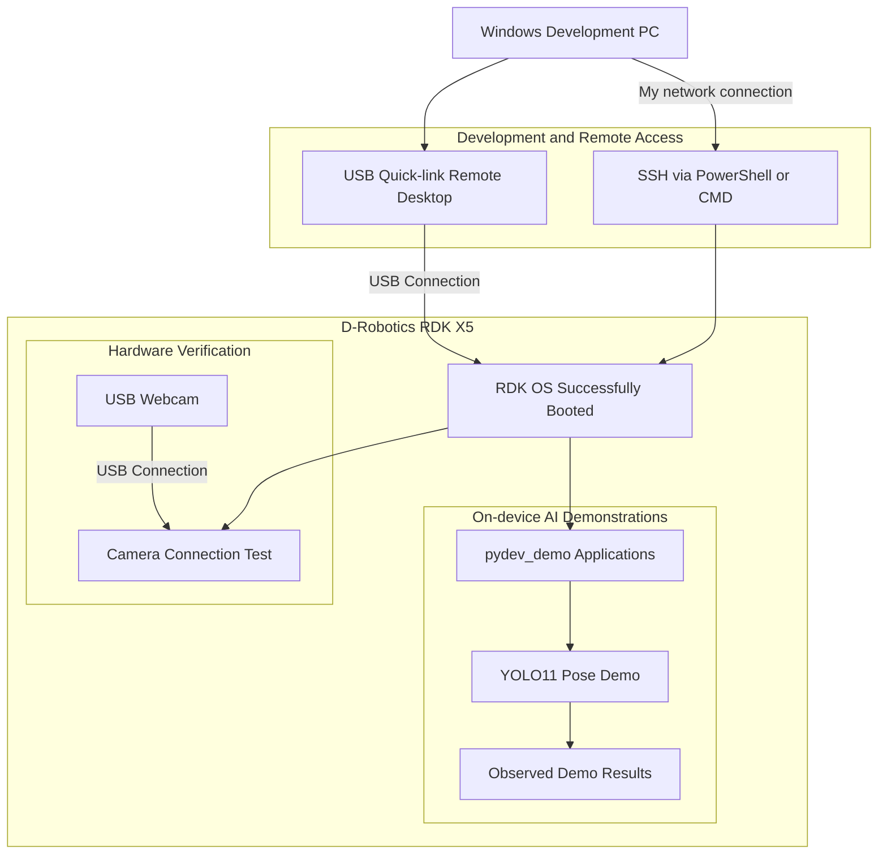

# rdk-x5-stage1-demo

- **Participant:** Mark
- **Stage completed:** 1
- **Repository:** https://github.com/markthesuperpro/rdk-x5-stage1
- **Community post:** [Discord](https://discord.com/channels/1300358874280230994/1503706103752429618/threads/1565947368782831757)
- **License:** [MIT License](https://github.com/markthesuperpro/rdk-x5-stage1/blob/main/LICENSE)

## Summary

Stage 1 completed. RDK x5 successfully bootup RDK OS and remote desktop via USB Quick-link. USB webcam were tested connected via the USB port. Demo projects have been run like the pydev_demo yolo11 pose model and others with the observed results. SSH connection is also tested via main device cmd/powershell. Overall, the project's stage 1 setup is doing great.

## Technical Highlights

- **RDK board / image:** RDK x5
- **Sensors and actuators:** USB Webcam
- **ROS 2 design:** N/A (yet)

## Architecture

Currently consists of Windows development computer running remote desktop via USB Quick-link, RDK x5 running RDK OS, SSH access, USB webcam and AI demonstration applications.

The architecture is divided into three main parts:
 1.Development and remote access
 2.RDK X5 hardware
 3.On-device AI demonstration

### Architecture Diagram

1. Development Computer

   Main development computer is a Window pc used to access and configure RDK X5 via:
   - SSH
   - Remote VNC Desktop

2. USB Webcam

   Main source of data connected via RDK X5 USB port.
   The webcam has been tested as a connected peripheral.

4. pydev_demo

   YOLO11 Pose is one of the tested application in this project.

5. Output

   The AI applications like pydev_demo examples produce outputs documented through:

     - Screenshots via Remote Desktop
     - Text logs
     - Video #TODO for stage 2,3

## Links and Evidence

- Stage evidence: https://github.com/markthesuperpro/rdk-x5-stage1/tree/main/evidence
- Benchmarks: https://github.com/markthesuperpro/rdk-x5-stage1/blob/main/README.md
- Documentation: https://github.com/markthesuperpro/rdk-x5-stage1/tree/main/docs #still empty

## Known Limitations and Safety

   Remote desktop via USB Quick-link speed is still really slow.

---

I agree that this showcase document may be used by the Robotics Dream Keeper Challenge organizers for program promotion, judging, and archives as described in the official README.
