# Autonomous-Quadruped-Assisting-Robot-A.Q.A.R

- **Participant:** Mark
- **Stage completed:** 2
- **Repository:** https://github.com/markthesuperpro/RDK-X5-A.Q.A.R-Stage2
- **Community post:** [Discord](https://discord.com/channels/1300358874280230994/1503706103752429618/threads/1565947368782831757)
- **License:** [MIT License](https://github.com/markthesuperpro/RDK-X5-A.Q.A.R-Stage2/blob/main/LICENSE)

## Summary

Stage 2 completed. As of previous stages, RDK X5 can successfully bootup RDK OS and remote desktop via USB Quick-link. Now in stage 2, we are developing a robot called A.Q.A.R which stands for Autonomous Quadruped Assistive Robot. It is powered by RDK X5 and ESP32. It is fitted with a Lidar and built-in camera. The robot architecture itself is very simple, it is fitted with 3 servos for each legs, enabling 12 DOF. In current status, we are currently developing how it map its environment using SLAM and navigation.

## Technical Highlights

- **RDK board / image:** RDK X5
- **Sensors and actuators:** Lidar, Sensors, Servo motors, IMU
- **ROS 2 design:** Humble + TROS

## Architecture

Our robot full architecture consists of RDK X5 board that recieves data from different input methods (e.g. Joystick, etc.), calculates high level Navigation, Mapping and publish ROS2 commands to ESP32 in which runs motor functions. 

The architecture is divided into three main parts:
 - 1.Inputs
 - 2.RDK X5 software and nodes
 - 3.ESP32 Firmware

### Architecture Diagram

```mermaid
flowchart LR
    %% INPUTS
    subgraph INPUTS["Inputs"]
        direction TB
        LIDAR["LiDAR"]
        IMU["IMU"]
        CAMERA["Camera"]
        JOYSTICK["Joystick"]
    end

    %% RDK X5
    subgraph RDK["RDK X5 — High-Level Processing"]
        direction TB

        subgraph NAV["Autonomous Navigation"]
            direction TB
            SLAM["SLAM<br/>Mapping & Localization"]
            NAV2["Nav2<br/>Path Planning & Navigation"]
            SLAM -->|"Map / Localization / TF"| NAV2
        end

        subgraph AI["AI Perception"]
            direction TB
            MODEL["AI Model"]
            OUTPUT["Output Node"]
            MODEL --> OUTPUT
        end
    end

    %% ESP32
    subgraph ESP["ESP32 — Low-Level Control"]
        direction TB
        NAV_IN["Navigation Command Input"]
        JOY_IN["Joystick Input"]
        MUX["Command Arbitration<br/>Manual / Autonomous / Safety"]
        GAIT["Gait & Servo Control Firmware"]

        NAV_IN --> MUX
        JOY_IN --> MUX
        MUX --> GAIT
    end

    %% OUTPUTS
    subgraph OUTPUTS["Physical Outputs"]
        direction TB
        SERVOS["Servos"]
        AUX["Other Event-Driven Outputs"]
    end

    %% NAVIGATION ROUTE
    LIDAR -->|"Laser Scan"| SLAM
    IMU -->|"Orientation / Angular Velocity"| SLAM
    NAV2 -->|"/cmd_vel via communication bridge"| NAV_IN
    GAIT --> SERVOS

    %% CAMERA / AI ROUTE
    CAMERA -->|"Image Frames"| MODEL
    OUTPUT --> AUX

    %% MANUAL CONTROL ROUTE
    JOYSTICK --> JOY_IN

    %% STYLING
    classDef sensor fill:#dbeafe,stroke:#2563eb,color:#172554
    classDef compute fill:#ede9fe,stroke:#7c3aed,color:#2e1065
    classDef control fill:#ffedd5,stroke:#ea580c,color:#431407
    classDef output fill:#dcfce7,stroke:#16a34a,color:#14532d

    class LIDAR,IMU,CAMERA,JOYSTICK sensor
    class SLAM,NAV2,MODEL,OUTPUT compute
    class NAV_IN,JOY_IN,MUX,GAIT control
    class SERVOS,AUX output
```




1. Inputs:

     - Manual Joystick (optional)
     - Camera <- for automatic eldery status detection
     - Lidar, IMU <- Automatic Sensory for Navigation and Mapping

2. RDK X5 stacks

    AI perceptions (stage 3):
     - Image classifier model
     - Model output node (e.g. /output)
    Autonomous Navigation:
     - SLAM & Nav Framework
     - Nav "/cmd_vel" <- Linear Velocity node

3. ESP32 Motor Control
   
    ```text
    Navigation command input ──┐
                               ├──► Firmware Predefined Commands ──► Servos Command
    Joystick manual input ─────┘
    ```


## Links and Evidence

# Stage 1 — Ignite Evidence
 - [SSH_logs](https://github.com/markthesuperpro/RDK-X5-A.Q.A.R-Stage2/blob/main/evidence/Flash_ssh.log)
 - [Sensors](https://github.com/markthesuperpro/RDK-X5-A.Q.A.R-Stage2/blob/main/evidence/Sensor.png)
 - [AI Demo](https://github.com/markthesuperpro/RDK-X5-A.Q.A.R-Stage2/blob/main/evidence/Yolo11_demo.png)
 - [Hardware setup](https://github.com/markthesuperpro/RDK-X5-A.Q.A.R-Stage2/blob/main/evidence/hardware.png)

# Stage 2 — Build Deliverables
 - [Proposal](https://github.com/markthesuperpro/RDK-X5-A.Q.A.R-Stage2/blob/main/PROPOSAL.md)
 - [Architecture](https://github.com/markthesuperpro/RDK-X5-A.Q.A.R-Stage2/blob/main/ARCHITECTURE.md)
 - [Roadmap](https://github.com/markthesuperpro/RDK-X5-A.Q.A.R-Stage2/blob/main/ROADMAP.md)
 - [Engineering_plan](https://github.com/markthesuperpro/RDK-X5-A.Q.A.R-Stage2/blob/main/docs/ENGINEERING_PLAN.md)

## Known Limitations and Safety

| # | Risk | Trigger | Mitigation |
|---|------|---------|------------|
| 1 | Lidar measurements unsuitable for mapping | Unstable or invalid range data / scan | Recalibration before SLAM integration |
| 2 | ESP32–RDK communication failure | Dropped messages, timeout or stale commands | Implement communication monitoring and command timeouts |
| 3 | Servos overheat | Unexpected power surges/ Inconsistency in commands | Replace Servo |

---

I agree that this showcase document may be used by the Robotics Dream Keeper Challenge organizers for program promotion, judging, and archives as described in the official README.
