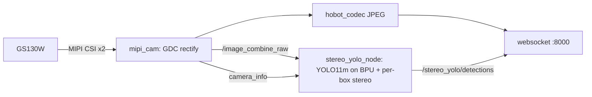

# RDK X5 Stereo YOLO: object detection with metric distance

- **Participant:** Om Gajjar
- **Stage completed:** 1
- **Repository:** <https://github.com/omgajjar1976/rdk-x5-stereo-yolo>
- **Demo video:** https://github.com/omgajjar1976/rdk-x5-stereo-yolo/tree/main/docs/images
- **Community post:** https://discord.com/channels/1300358874280230994/1574712116047515648/1575423831630286938
- **License:** Apache-2.0

## Summary

Most Stage 1 demos run YOLO on one camera and stop at a box. I wanted every detection to say how far away the object is,
measured on the board itself, because that is what a robot needs before it can stop, steer or grasp. The RDK X5 runs
YOLO11m on the BPU on the left image of the RDK Stereo Camera GS130W. My own ROS 2 node then finds each box in the
rectified right image (NCC patch matching along the row, sub-pixel, median) and converts the shift to metres using the
camera's factory calibration, which I read out of its EEPROM (baseline 80.02 mm). The distance is plain stereo geometry,
so this stays a single on-device AI task.

I checked it against a tape measure: a box at 60 cm reads 60.9 cm (+1.5 %), a cup at 60 cm reads 60.4 cm and a
transparent bottle at 30 cm reads 30–31.5 cm. Along the way I found and documented 10 problems in the stock stack.
Examples: the sample dequantizer skips scale-quantized outputs, so YOLOv8n boxes come out wrong; the GS130W's default
rotation gives vertical disparity and scrambled camera_info; a slow letterbox (25 ms, against ~1 ms with NV12). I worked
around four of them in code and plan upstream pull requests. Results: 5–6 fps end to end in Python, BPU benchmarks for
five YOLO models, and a troubleshooting table of every failure I hit.

## Technical Highlights

- **RDK board / image:** RDK X5 4 GB, RDK OS 3.5.0 server (Ubuntu 22.04, kernel 6.1.83), tros-humble 2.5.2
- **AI model and runtime:** YOLO11m (Bayes-e, 640x640 NV12) via `hbm_runtime` on the BPU. Own decode with per-channel
  dequant, OpenCV NMS, NV12 letterbox
- **Sensors and actuators:** RDK Stereo Camera GS130W (2x SC132GS, 1280x1088) on both MIPI CSI ports, I2C 0x33 on bus 6
  and 0x32 on bus 4; no actuators
- **ROS 2 design:** `mipi_cam` (GDC rectification, `mipi_rotation:=90.0`) → `stereo_yolo_node` →
  `/stereo_yolo/detections` (`ai_msgs/PerceptionTargets`, label "class X.XXm" plus distance attributes) → `websocket` viewer
- **BPU evidence and performance:** `hrt_model_exec`: YOLOv8n 12.1 ms, YOLO11m 40.5 ms (BPU only). Live pipeline: YOLO
  72–76 ms incl. pre/post, stereo 80–86 ms per box, 5.4–6.2 fps, frame age ~230 ms

## Architecture

## Links and Evidence

- Flash + SSH: https://github.com/omgajjar1976/rdk-x5-stereo-yolo/blob/main/docs/images/01_flash_ssh_rdkos_info.png
- Sensor proof (MIPI, init success, rate, internet): https://github.com/omgajjar1976/rdk-x5-stereo-yolo/blob/main/docs/images/02_camera_init_rate_internet.png
- AI output with distance: https://github.com/omgajjar1976/rdk-x5-stereo-yolo/blob/main/docs/images/04_ai_bottle_30cm.jpg
- Benchmarks and accuracy table: https://github.com/omgajjar1976/rdk-x5-stereo-yolo#results
- Stock-stack issues: https://github.com/omgajjar1976/rdk-x5-stereo-yolo/blob/main/UPSTREAM_ISSUES.md

## Known Limitations and Safety

Transparent and textureless objects give fewer stereo matches; accuracy is measured only up to 60 cm; 5–6 fps in Python
(C++ zero-copy node planned). No actuators in Stage 1, so nothing moves.

---

I agree that this showcase document may be used by the Robotics Dream Keeper Challenge organizers for program promotion, judging, and archives as described in the official README.
