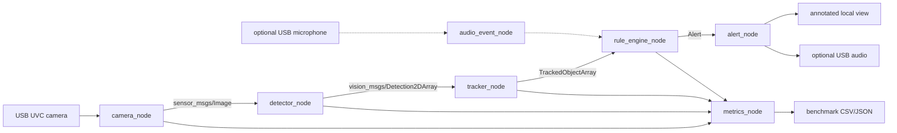

# RDK Edge Guardian — Privacy-First Assistive Vision on RDK X5

- **Participant:** Rshi (`rshiperfect-ux`)
- **Stages completed:** Stage 1 — Ignite; Stage 2 — Build
- **Repository:** https://github.com/rshiperfect-ux/rdk-x5-stage1-yolo
- **Stage 2 proposal:** https://github.com/rshiperfect-ux/rdk-x5-stage1-yolo/blob/main/PROPOSAL.md
- **Architecture:** https://github.com/rshiperfect-ux/rdk-x5-stage1-yolo/blob/main/ARCHITECTURE.md
- **Engineering plan:** https://github.com/rshiperfect-ux/rdk-x5-stage1-yolo/blob/main/ENGINEERING_PLAN.md
- **Roadmap:** https://github.com/rshiperfect-ux/rdk-x5-stage1-yolo/blob/main/ROADMAP.md
- **Community thread:** https://discord.com/channels/1300358874280230994/1503706103752429618/threads/1566848506369548388
- **License:** Apache-2.0

## Project Summary

RDK Edge Guardian is a privacy-first, on-device visual assistant for a desk, room, or small workspace. A user defines safety zones and target object classes. The system captures a continuous USB-camera stream, runs YOLOv5 inference on the RDK X5 BPU, assigns short-lived track IDs on the CPU, evaluates zone and dwell-time rules, and produces a local visual or optional audio alert. Camera frames remain on the RDK X5 by default.

Stage 1 established the working hardware baseline: RDK OS 3.2.3, SSH and internet connectivity, a Sunplus Full HD USB UVC camera, and successful YOLOv5s inference through the D-Robotics DNN runtime. Stage 2 converts that verified demo into a scoped ROS 2 system design, compute plan, BOM, risk register, validation strategy, and dated implementation roadmap.

## Intended User and Scenario

The intended users are makers, home users, and small-workspace operators who need a low-cost local safety assistant without cloud video processing. The first demonstration uses a fixed camera and a configured polygonal zone. It will distinguish a brief object crossing from an object that remains beyond a dwell threshold, publish an alert, display the annotated result, and record performance diagnostics.

The system is advisory only and is not a certified safety or medical product. No face recognition, personal identity database, or cloud frame upload is planned.

## Capabilities and Innovation

| Layer | Planned capability |
|---|---|
| Perception | Continuous YOLOv5s 672x672 NV12 detection on the RDK X5 BPU |
| Temporal reasoning | Lightweight CPU tracking with short-lived IDs |
| Decision | Configurable class, confidence, polygon, dwell-time, hysteresis, and cooldown rules |
| Actuation | Annotated local view, ROS 2 alert event, and optional USB audio notification |
| Reliability | FPS/latency/drop metrics, node heartbeat, stale-data rejection, and camera reconnect |
| Privacy | Edge-only default runtime with no off-board inference or frame upload |

This goes beyond the stock still-image demo by adding continuous ROS 2 operation, two concurrent compute workloads, stateful zone reasoning, configuration-driven behavior, measured performance, and recovery behavior. Optional timestamped audio confirmation is isolated as a stretch feature so it cannot block the camera-first deliverable.

## Measurable Stage 3 Targets

These are design targets, not measured claims. Stage 3 will publish raw benchmark logs and measured average, median, and p95 values.

| Metric | Minimum target |
|---|---:|
| Processed frame rate | 10 FPS |
| End-to-end frame-to-alert latency | p95 <= 250 ms |
| Zone-event success | At least 8/10 scripted trials |
| False alerts in an empty zone | At most 1 per 10 minutes |
| Camera reconnect recovery | Within 15 seconds |
| Continuous demonstrated operation | At least 5 minutes, with a 30-minute soak-test target |

## System Architecture

### Compute allocation

- **BPU:** YOLOv5 neural-network inference.
- **CPU:** UVC capture, NV12 preparation/post-processing, tracking, rule state machine, ROS 2 transport, metrics, and optional audio processing.
- **RDK storage/memory:** model, configuration, bounded latest-frame queues, and short diagnostic logs.
- **Windows PC:** development, SSH, documentation, optional viewing, and final video editing; not required for runtime decisions.
- **Cloud:** none in the default runtime.

The required camera-first graph and complete ROS 2 topic/service table are documented in [ARCHITECTURE.md](https://github.com/rshiperfect-ux/rdk-x5-stage1-yolo/blob/main/ARCHITECTURE.md).

## Engineering Plan

The project reuses the existing RDK X5, 64 GB microSD card, verified UVC webcam, power supply, and local network. No new camera is required. A USB speaker and microphone are optional; the webcam will first be checked for an exposed audio device.

The five principal risks are stream performance, BPU model/runtime compatibility, unstable tracker alerts, USB disconnect/device renumbering, and optional audio schedule risk. Each has an observable trigger, mitigation, and camera-first fallback in [ENGINEERING_PLAN.md](https://github.com/rshiperfect-ux/rdk-x5-stage1-yolo/blob/main/ENGINEERING_PLAN.md).

The dated [ROADMAP.md](https://github.com/rshiperfect-ux/rdk-x5-stage1-yolo/blob/main/ROADMAP.md) prioritizes the required ROS 2 detector, tracker, zone rules, metrics, and recovery path before optional features. It reserves December 10–11 for the 3–7 minute demo recording and December 14–15 for final submission and buffer.

## Stage 1 Evidence

- SSH and internet: https://github.com/rshiperfect-ux/rdk-x5-stage1-yolo/blob/main/evidence/ssh_internet_evidence.png
- RDK OS and SD-card layout: https://github.com/rshiperfect-ux/rdk-x5-stage1-yolo/blob/main/evidence/system_sd_evidence.png
- USB camera frame: https://github.com/rshiperfect-ux/rdk-x5-stage1-yolo/blob/main/evidence/camera_evidence_02.jpg
- YOLOv5 BPU result: https://github.com/rshiperfect-ux/rdk-x5-stage1-yolo/blob/main/evidence/yolo_camera_result_02.jpg
- BPU inference log: https://github.com/rshiperfect-ux/rdk-x5-stage1-yolo/blob/main/evidence/yolo_camera_result_02.log

## Current Status and Next Step

Stage 1 is complete and the Stage 2 design package is public. The next implementation step is to create the ROS 2 package skeleton, confirm the board's ROS 2 and audio-device state, and benchmark sustained USB-camera capture before integrating continuous BPU inference.

---

I agree that this showcase document may be used by the Robotics Dream Keeper Challenge organizers for program promotion, judging, and archives as described in the official README.

