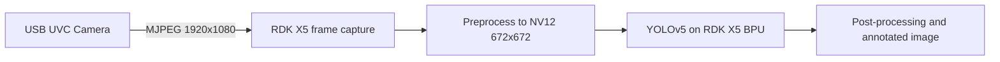

# RDK X5 USB Camera YOLOv5 BPU Demo

- **Participant:** Rshi (`rshiperfect-ux`)
- **Stage completed:** 1
- **Repository:** https://github.com/rshiperfect-ux/rdk-x5-stage1-yolo
- **Demo / AI evidence:** https://github.com/rshiperfect-ux/rdk-x5-stage1-yolo/blob/main/evidence/yolo_camera_result_02.jpg
- **Community post:** https://discord.com/channels/1300358874280230994/1503706103752429618/threads/1566848506369548388
- **License:** Apache-2.0

## Summary

This Stage 1 project demonstrates a complete first bring-up and on-device AI workflow on the D-Robotics RDK X5. The board was flashed with RDK OS 3.2.3, connected to the local network, accessed over SSH from a Windows development computer, and verified to have working internet access. A Sunplus Full HD USB UVC webcam was then connected and used to capture an original 1920x1080 MJPEG frame. The captured image was passed to the YOLOv5 model supplied with the RDK OS image and inference was executed through the RDK DNN runtime on the BPU. The resulting image visibly identifies a mobile phone, while the accompanying log records the BPU platform and runtime initialization plus the detected class. The public repository contains the Python inference script, reproducible commands, dependencies, system and SD-card evidence, the original camera frame, the annotated AI result, the BPU log, and troubleshooting notes. This provides a compact, reproducible foundation for a future camera-based assistive vision robot.

## Technical Highlights

- **RDK board / image:** D-Robotics RDK X5; RDK OS 3.2.3; Ubuntu 22.04.5 LTS; Linux 6.1.83 aarch64.
- **AI model and runtime:** YOLOv5s 672x672 NV12 model with D-Robotics DNN Runtime 1.24.5 / HBRT 3.15.55.0.
- **Sensors and actuators:** Sunplus Full HD USB UVC webcam (`1bcf:2283`), MJPEG capture at 1920x1080 and 30 FPS; no actuator in Stage 1.
- **ROS 2 design:** ROS 2 is not used in Stage 1; a camera-to-detector-to-visualizer graph is planned for a later stage.
- **BPU evidence and performance:** BPU Platform 1.3.6 initialized successfully and detected the `cell phone` class. No end-to-end FPS benchmark was recorded in Stage 1.

## Architecture

The USB camera supplies the participant-owned input frame. The RDK X5 prepares the model input, runs YOLOv5 inference on the BPU, and writes an annotated result image together with a text log.

## Links and Evidence

- Flash, SSH, and internet evidence: https://github.com/rshiperfect-ux/rdk-x5-stage1-yolo/blob/main/evidence/ssh_internet_evidence.png
- System and SD-card evidence: https://github.com/rshiperfect-ux/rdk-x5-stage1-yolo/blob/main/evidence/system_sd_evidence.png
- USB camera proof: https://github.com/rshiperfect-ux/rdk-x5-stage1-yolo/blob/main/evidence/camera_evidence_02.jpg
- YOLOv5 BPU output: https://github.com/rshiperfect-ux/rdk-x5-stage1-yolo/blob/main/evidence/yolo_camera_result_02.jpg
- BPU inference log: https://github.com/rshiperfect-ux/rdk-x5-stage1-yolo/blob/main/evidence/yolo_camera_result_02.log
- Documentation and reproducible commands: https://github.com/rshiperfect-ux/rdk-x5-stage1-yolo#readme

## Known Limitations and Safety

The Stage 1 demo processes a still image and does not report real-time FPS or latency. Detection accuracy depends on lighting, camera placement, and the COCO classes supported by the model. The project has no motor or physical actuator, so it cannot cause motion-related hazards. Images should be captured with the consent of people in view and should not expose private information.

---

I agree that this showcase document may be used by the Robotics Dream Keeper Challenge organizers for program promotion, judging, and archives as described in the official README.

