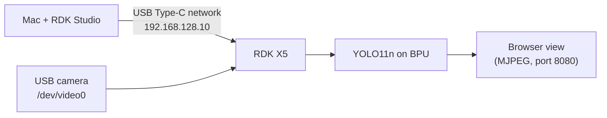

# Home Court Robot

- **Participant:** Shu
- **Stage completed:** 1
- **Repository:** https://github.com/shoujiki-panman/rdk-x5-home-court-robot
- **Demo video:** Stage 1 evidence images in the repository (see Links and Evidence)
- **Community post:** [Stage 1 check-in in Shu’s Discord thread](https://discord.com/channels/1300358874280230994/1566820028366585957/1569393185879228456)
- **License:** [MIT License](https://github.com/shoujiki-panman/rdk-x5-home-court-robot/blob/main/LICENSE)

## Summary

Home Court Robot is a home robot that settles small family arguments, such as who ate the last snack, by looking at evidence instead of taking sides. RDK X5 is the brain: it watches the living room with a camera and detects events on the BPU, so family video never leaves the house. My StackChan desktop robot is the body: it turns to the person speaking, shows the logged evidence, and nods down like a gavel to announce a verdict.

For Stage 1, I brought up an RDK X5 at DUG Tokyo #1 in Akihabara on 2026-10-31. I connected it to a Mac with RDK Studio (RDK Type-C direct), logged in over SSH with a dedicated key, and recorded the system image and kernel. I attached a USB camera (ELECOM UCAM-C0220F), which appeared as `/dev/video0`, and captured frames with ffmpeg. Then I ran the official YOLO11n detection sample on the BPU, first on the sample image and then on live camera frames. A small script streams the live detections to a browser, and it ran at about 28 FPS with about 25 ms per frame.

On 2026-11-10, I repeated the bring-up on a second RDK X5. I flashed RDK OS 3.5.0 Desktop with RDK Studio, booted the board, and connected from my Mac over USB-C SSH. The board reached the D-Robotics archive over Wi-Fi (HTTPS 200 with certificate verification). FFmpeg captured a 640×480 frame from a Logitech C270 on `/dev/video0`. The official YOLO11n sample ran on the BPU and saved detection results for both the C270 frame and the official `kite.jpg` sample.

## Technical Highlights

- **RDK board / image:** RDK X5, Ubuntu 22.04.5 LTS, kernel 6.1.83, RDK OS 3.5.0
- **AI model and runtime:** `yolo11n_detect_bayese_640x640_nv12.bin` (COCO 80 classes) with the official `pydev_demo` YOLO11 sample (`hbm_runtime`)
- **Sensors and actuators:** USB cameras on `/dev/video0`: ELECOM UCAM-C0220F (October 31) and Logitech C270 (November 10). No actuators yet.
- **ROS 2 design:** Not yet (planned for Stage 2)
- **BPU evidence and performance:** The October 31 live-camera run reached 28.4 FPS at 640×480, with about 25 ms per frame for preprocessing, inference, and postprocessing. The November 10 retest used still images.

## Architecture

The October 31 live demo streamed YOLO11n detections to a browser. Both runs used USB-C SSH from the Mac and ran inference on the RDK X5’s BPU.

## Links and Evidence

The linked files below are from the October 31 run on the venue loaner. The November 10 run is documented above and in the Discord check-in.

- Flash and SSH evidence: [01-ssh-system-info.txt](https://github.com/shoujiki-panman/rdk-x5-home-court-robot/blob/main/evidence/01-ssh-system-info.txt)
- Sensor proof: [02-camera-capture-blurred.jpg](https://github.com/shoujiki-panman/rdk-x5-home-court-robot/blob/main/evidence/02-camera-capture-blurred.jpg)
- AI output: [03-yolo11-kite.jpg](https://github.com/shoujiki-panman/rdk-x5-home-court-robot/blob/main/evidence/03-yolo11-kite.jpg), [04-yolo11-camera-blurred.jpg](https://github.com/shoujiki-panman/rdk-x5-home-court-robot/blob/main/evidence/04-yolo11-camera-blurred.jpg)
- Documentation: [README](https://github.com/shoujiki-panman/rdk-x5-home-court-robot#readme)

## Known Limitations and Safety

- People's faces in the camera shots are pixelated before publishing.
- There are no moving parts yet. When StackChan is added in Stage 3, its head motion will have speed limits and a stop command.

---

I agree that this showcase document may be used by the Robotics Dream Keeper Challenge organizers for program promotion, judging, and archives as described in the official README.
