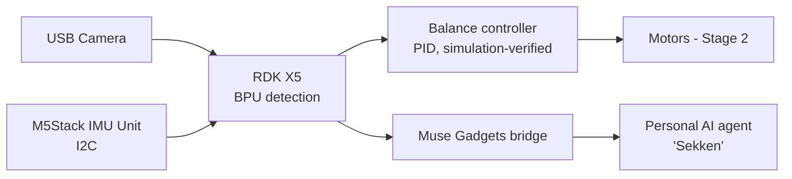

# Sekken Rover Muse

- **Participant:** Yoshihito Kondoh
- **Stage completed:** 1
- **Repository:** https://github.com/GOROman/sekken-rover-muse
- **Demo video:** Stage 1 evidence post (with detection screenshots): https://discord.com/channels/1300358874280230994/1568442571301068850/1568525991733887056 — a demo video follows in Stage 2
- **Community post:** https://discord.com/channels/1300358874280230994/1568442571301068850/1568525991733887056 (Discord Stage 1 post in the "RDK Challenge - 11/07/26 - Yoshihito" thread, 🤖D-Robotics Community)
- **License:** MIT

## Summary

Sekken Rover Muse gives a personal AI agent a body. The author already runs
an always-on AI assistant ("Sekken") that manages mail, calendar, smart-home
devices and a lifelog; until now it could only act through chat and connected
services. This project mounts that agent on a two-wheel self-balancing robot
driven by an RDK X5, so the agent can move around the room, look at things
through a camera, and eventually carry out small physical tasks. The robot
balances as an inverted pendulum using IMU attitude sensing, and when its
battery runs low it returns to its charging dock by itself, so it can live in
the room continuously without supervision. For Stage 1, the board bring-up
(flash, network, SSH), a camera-based sensor check, and an on-device
detection task on the BPU are completed and evidenced, and the robot's
control skeleton — plant model, PID balance control, battery-aware return
state machine — is implemented and verified with 12 unit tests in
simulation, ready to be ported to the real chassis in Stage 2.

## Technical Highlights

- **RDK board / image:** RDK X5 with the official RDK OS 3.5.0 Desktop image written to a 32GB microSD; first boot verified on the board (rootfs auto-expanded to the full card)
- **Network / SSH:** Wired Ethernet ships with a fixed IP (192.168.127.10); reconfigured netplan to DHCP and enabled Wi-Fi, so the board is reachable over SSH on both interfaces
- **AI model and runtime:** YOLOv8x object detection from the official pydev_demo running on the BPU (13 detections on the test image: 7× person, 6× kite); YOLOv5x also run on live USB-camera frames
- **Sensors and actuators:** USB camera (UVC) verified live for Stage 1 evidence; M5Stack IMU Unit (I2C) for attitude sensing (in transit, ETA ~Nov 10); encoder motors and chassis follow in Stage 2
- **ROS 2 design:** Planned for Stage 2 — camera → detector → agent bridge graph; Stage 1 control skeleton is plain Python (standard library only)
- **BPU evidence and performance:** Detection screenshots from the participant's own board (linked from the repository README)

## Architecture

The RDK X5 is the robot's brain: it runs perception on the BPU and hosts the
balance-control loop. A bridge connects the board to the author's Muse
Gadgets ecosystem, which is how the resident AI agent will perceive and act
through the robot from Stage 2 onward.

## Links and Evidence

- Flash and SSH evidence: Screenshots attached to the Discord Stage 1 post (link above); logs and images also kept in the project evidence archive
- Sensor proof: USB camera live frames with on-BPU detection (camera pointed at the RDK X5 board itself); IMU read-out to be added when the unit arrives
- AI output: YOLOv8x detection screenshot from this board, attached to the Discord post
- Documentation: Repository README (setup, commands, dependencies, troubleshooting)

## Known Limitations and Safety

- Stage 1 is a board bring-up stage: the chassis, motors and self-balancing
  on real hardware are Stage 2 work; the control code is currently verified
  in simulation only and is labelled as such.
- The IMU was still in transit at the time of writing (ETA ~Nov 10), so the
  Stage 1 sensor evidence starts with the camera path.
- Motion tests will run at reduced speed with a clear fall zone; the state
  machine cuts drive output on excessive tilt (fall protection).
- No Wi-Fi passwords, tokens, private keys or device serials are published.

---

I agree that this showcase document may be used by the Robotics Dream Keeper Challenge organizers for program promotion, judging, and archives as described in the official README.
