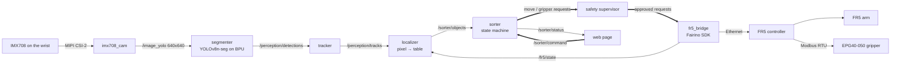

# Vision-Guided Desk Sorter: RDK X5 Eyes on a Fairino FR5 Arm

- **Participant:** ZakiePanahipour
- **Stage completed:** 2
- **Repository:** https://github.com/Spnh2000/rdk-x5-dreamkeeper
- **Proposal:** https://github.com/Spnh2000/rdk-x5-dreamkeeper/blob/main/docs/stage2/PROPOSAL.md
- **Architecture:** https://github.com/Spnh2000/rdk-x5-dreamkeeper/blob/main/docs/stage2/ARCHITECTURE.md
- **Engineering plan:** https://github.com/Spnh2000/rdk-x5-dreamkeeper/blob/main/docs/stage2/ENGINEERING_PLAN.md
- **Roadmap:** https://github.com/Spnh2000/rdk-x5-dreamkeeper/blob/main/ROADMAP.md
- **Demo video (Stage 1):** https://github.com/Spnh2000/rdk-x5-dreamkeeper/blob/main/docs/stage1/05-yolo-demo.gif
- **Community post:** https://discord.com/channels/1300358874280230994/1565637529737105498
- **License:** GPL-2.0 (the camera driver is derived from the GPL-2.0 Raspberry Pi Linux driver)

## Summary

Industrial arms repeat taught paths well, but a taught path only works when
every object is always in the same place. To handle objects lying anywhere,
the arm has to see them, and vision for industrial arms is usually an
expensive, closed, PC-based product. This project shows that a low-cost
embedded board riding on the arm can provide the eyes and the decisions.

An RDK X5 and an IMX708 camera are mounted on the wrist of a Fairino FR5
collaborative arm with a Jodell EPG40-050 electric gripper. The arm surveys a
table, a YOLOv8 segmentation model on the BPU finds and outlines everyday
objects (bottles, cups, cutlery, scissors, toothbrushes, bananas), and the
RDK X5 turns each mask into a table position and grasp angle using the wrist
pose and a hand-eye calibration. Above each object the camera checks again
from close up, then the arm grasps it and drops it into the bin for its kind.
A safety supervisor checks every command before it reaches the arm; a web
page starts, pauses and stops the run.

Stage 1 delivered the base: a kernel driver ported so the IMX708 works on the
X5, and YOLOv8n on the BPU at 56 detections/s with 7 ms inference. Stage 2
adds the proposal, the system and ROS 2 architecture, the compute plan, a
parts list, five risks with fallbacks, and a dated roadmap to the final demo
on 15 December. The arm, gripper and mounting are in place and their
specifications have been checked on site.

## Intended User and Scenario

Lab staff or makers who want a tidy work area without teaching the robot
every object position, and visitors watching a demonstration. Up to 8
objects lie at random on a table of about 60 x 80 cm next to the arm; three
labelled bins stand at fixed positions. The user starts a run from a web page
and can stop it at any time; the arm's hardware emergency stop always
overrides the software. Objects the robot cannot classify or grasp stay on
the table and are listed.

## Capabilities and Innovation

| Layer | Capability |
|-------|------------|
| Perception | IMX708 on the wrist at 56 fps; YOLOv8n-seg on the BPU for class, box and mask; position on the table from pixel ray + wrist pose + table plane |
| Decision | sorting state machine (survey → choose → approach → close-up check → grasp → verify → place); grasp check from the gripper finger position |
| Actuation | FR5 (controller v3.9.8) commanded over Ethernet with Fairino's official SDK; EPG40-050 gripper (Modbus RTU) through the controller |
| Safety | software workspace box and minimum height, speed ≤ 250 mm/s, heartbeat with automatic stop, controller collision detection, hardware e-stop |

Compared with a stock demo: a sensor with no X5 support made to work by a
ported driver; detection closes the loop to an industrial arm; the camera
moves with the arm (survey from far, correct from close up); masks give the
grasp angle instead of axis-aligned boxes; no PC in the loop.

## Measurable Stage 3 Targets

Design targets, measured at the final demo over 20 objects placed at random.

| Metric | Target |
|--------|--------|
| Detection rate on the BPU, live camera | ≥ 30 fps (Stage 1 measured: 56 fps) |
| Segmentation latency on the BPU | ≤ 30 ms per frame |
| Image-to-arm-command latency | ≤ 100 ms |
| Grasp position error on the table | ≤ 10 mm |
| Classification accuracy of sorted objects | ≥ 90 % |
| Objects sorted into the correct bin | ≥ 80 % of 20 |
| Cycle time per object | ≤ 20 s |
| Safety | 0 workspace violations; e-stop tested before every session |

## Technical Highlights

- **RDK board / image:** D-Robotics RDK X5; RDK OS 3.5.0, Ubuntu 22.04.5, Linux 6.1.83, TogetheROS Humble; mounted on the arm.
- **AI model and runtime:** YOLOv8n-seg (instance segmentation, 640x640 NV12) on the BPU; Stage 1 YOLOv8n detection measured at 7 ms per frame.
- **Sensors and actuators:** Arducam IMX708 12 MP over MIPI CSI-2 + I2C (ported V4L2 driver), FR5 joint encoders and TCP pose, gripper finger position; Fairino FR5 6-axis cobot, Jodell EPG40-050 parallel gripper (0–40 mm, 2–50 N).
- **ROS 2 design:** imx708_cam → segmenter → tracker → localizer → sorter → safety_supervisor → fr5_bridge; custom `sorter_msgs` with a `MoveToPose` action and `Gripper` service; every arm command passes the supervisor.
- **Compute allocation:** BPU: segmentation (budget ≤ 30 ms, ≤ 60 % load). ISP/VSE: scaling; JPU: JPEG for the web view. CPU: camera, mask decoding, tracking, localisation, state machine, supervisor, SDK (≤ 2 of 8 cores). FR5 controller: kinematics, motion planning, collision detection. No off-board service.

## System Architecture

The RDK X5 runs the camera, the AI and all decisions; the FR5 controller
plans and executes every motion. Positions are computed only from images
taken while the arm stands still, which avoids tight camera-to-arm time
synchronisation. Full module table, topic and service tables with message
types and rates, and the calibration plan are in
[ARCHITECTURE.md](https://github.com/Spnh2000/rdk-x5-dreamkeeper/blob/main/docs/stage2/ARCHITECTURE.md).

## Engineering Plan

The arm, gripper, RDK X5, camera, network equipment and 3D-printed mounts are
in hand; only the sorting bins and a printed ChArUco calibration board
remain (about 15 EUR). The top five risks are grasp position error, the
segmentation model, limited arm time, hardware on the moving arm, and unsafe
motion; each has a trigger, mitigation and fallback in
[ENGINEERING_PLAN.md](https://github.com/Spnh2000/rdk-x5-dreamkeeper/blob/main/docs/stage2/ENGINEERING_PLAN.md).
Arm access is a few sessions per week, so the
[ROADMAP.md](https://github.com/Spnh2000/rdk-x5-dreamkeeper/blob/main/ROADMAP.md)
gives each of seven arm sessions one fixed goal and develops the rest off the
arm with a mock arm and recorded camera data: M1 perception + arm connection
(3 Dec), M2 one object sorted end to end (10 Dec), M3 benchmarks, demo video
and submission (15 Dec).

## Links and Evidence

- Stage 2 design: [proposal](https://github.com/Spnh2000/rdk-x5-dreamkeeper/blob/main/docs/stage2/PROPOSAL.md), [architecture](https://github.com/Spnh2000/rdk-x5-dreamkeeper/blob/main/docs/stage2/ARCHITECTURE.md), [engineering plan](https://github.com/Spnh2000/rdk-x5-dreamkeeper/blob/main/docs/stage2/ENGINEERING_PLAN.md), [roadmap](https://github.com/Spnh2000/rdk-x5-dreamkeeper/blob/main/ROADMAP.md)
- Stage 1 flash and SSH: https://github.com/Spnh2000/rdk-x5-dreamkeeper/blob/main/docs/stage1/01-flash.png, https://github.com/Spnh2000/rdk-x5-dreamkeeper/blob/main/docs/stage1/02-ssh.png
- Stage 1 sensor (MIPI CSI-2 + I2C, ROS 2 node): https://github.com/Spnh2000/rdk-x5-dreamkeeper/blob/main/docs/stage1/04-sensor.log, https://github.com/Spnh2000/rdk-x5-dreamkeeper/blob/main/docs/stage1/04-camera-frame.jpg
- Stage 1 AI on the BPU: https://github.com/Spnh2000/rdk-x5-dreamkeeper/blob/main/docs/stage1/05-yolo-browser.png, https://github.com/Spnh2000/rdk-x5-dreamkeeper/blob/main/docs/stage1/05-yolo-detections.jpg
- Stage 1 benchmarks: https://github.com/Spnh2000/rdk-x5-dreamkeeper/blob/main/docs/stage1/05-yolo.log
- Documentation (setup, commands, dependencies, troubleshooting): https://github.com/Spnh2000/rdk-x5-dreamkeeper#readme

## Known Limitations and Safety

- Stage 2 is a design: the Stage 3 targets above are not yet measured. The segmentation latency on the BPU is the first measurement planned.
- One camera without depth: objects must lie flat on the known table plane, not stacked; the gripper needs a grasp point narrower than about 38 mm and objects under 0.8 kg.
- The ISP tuning is borrowed from the IMX477, and the sensor can lock its I2C bus (power-cycle recovery is documented).
- The FR5 is a real industrial arm in a shared workplace: collaborative mode at ≤ 250 mm/s, the controller's collision detection, a software workspace box and minimum height, a heartbeat that stops the arm when the RDK X5 goes silent, the hardware e-stop tested before every session, and a person always present.
- Published images show objects only; no faces, Wi-Fi passwords, tokens, keys, device serials or network addresses.

---

I agree that this showcase document may be used by the Robotics Dream Keeper Challenge organizers for program promotion, judging, and archives as described in the official README.
