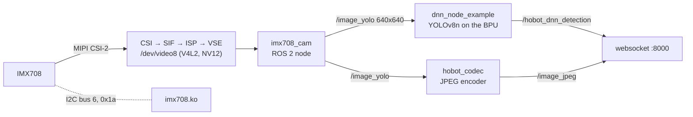

# IMX708 Camera + YOLOv8 on the RDK X5 BPU

- **Participant:** ZakiePanahipour
- **Stage completed:** 1
- **Repository:** https://github.com/Spnh2000/rdk-x5-dreamkeeper
- **Demo video:** https://github.com/Spnh2000/rdk-x5-dreamkeeper/blob/main/docs/stage1/05-yolo-demo.gif
- **Community post:** https://discord.com/channels/1300358874280230994/1565637529737105498
- **License:** GPL-2.0 (the camera driver is derived from the GPL-2.0 Raspberry Pi Linux driver)

## Summary

The RDK X5 ships with drivers for a handful of camera sensors, but not for the
Sony IMX708, the 12 MP sensor of the Raspberry Pi Camera Module 3 and of many
low-cost Arducam modules. This Stage 1 project brings up an RDK X5 from a fresh
RDK OS 3.5.0 image, makes an Arducam IMX708 camera work on it, and runs
real-time YOLO object detection on the board's BPU with that camera.

The Raspberry Pi kernel driver was ported to the X5 camera pipeline in its V4L2
mode: a single source pad, embedded-data lines off, and one 2x2-binned,
centre-cropped 1920x1080 mode at 56 fps, plus a CAM0 device tree overlay and
ISP files. A small rclpy node streams NV12 frames from `/dev/video8` into
ROS 2. Because the TogetheROS YOLO example resizes images through a stack that
is not available in V4L2 mode, the node also publishes a letterboxed 640x640
image, which the detector uses directly.

Result: YOLOv8n runs on every camera frame, at 56 detections per second, with
6-7 ms BPU inference and 18 ms from frame to result. The live view with boxes
is served in the browser. The public repository contains the driver, an
install script that reproduces the setup from a fresh header tree, the ROS 2
node and launch file, evidence, and troubleshooting notes. These include how to
recover from a sensor that locks its I2C bus. This camera pipeline is the
foundation for the next stages.

## Technical Highlights

- **RDK board / image:** D-Robotics RDK X5; RDK OS 3.5.0 (`rdk-x5-ubuntu22-preinstalled-desktop-3.5.0-arm64`), Ubuntu 22.04.5, Linux 6.1.83, TogetheROS Humble.
- **AI model and runtime:** YOLOv8n, 640x640 NV12, 80 COCO classes (`/opt/hobot/model/x5/basic/yolov8_640x640_nv12.bin`), run by TogetheROS `dnn_node_example` 2.6.1 on the BPU.
- **Sensors and actuators:** Arducam IMX708 12 MP camera on CAM0: video over MIPI CSI-2 (2 lanes), control over I2C (bus 6, address `0x1a`), out-of-tree V4L2 driver ported from Raspberry Pi Linux; 1920x1080 at 56 fps, scaled in hardware. No actuators in Stage 1.
- **ROS 2 design:** `imx708_cam` (rclpy, V4L2 mmap) publishes `/image_raw` (960x544 NV12) and `/image_yolo` (640x640 letterbox); `dnn_node_example` publishes `/hobot_dnn_detection` (`ai_msgs/PerceptionTargets`); `hobot_codec` (hardware JPEG) and `websocket` serve the live view on port 8000.
- **BPU evidence and performance:** measured on the board: 6-7 ms inference, 1 ms preprocessing, 3-4 ms post-processing, 18 ms from frame to result, 56 detections/s, BPU load 21 % (`hrut_somstatus`), about 25 % of the 8 CPU cores for the whole pipeline.

| Stage | Rate / time |
|-------|-------------|
| Camera → `/image_raw`, `/image_yolo` | 56 fps |
| YOLOv8n inference on the BPU | 6-7 ms |
| Frame to detection result | 18 ms |
| Detection output `/hobot_dnn_detection` | 56 Hz |
| Hardware JPEG for the web view | 56 fps |
| BPU load while detecting at 56 Hz | 21 % |

## Architecture

The sensor is controlled over I2C by the ported driver. Its frames pass the X5
camera pipeline, which scales them in hardware and delivers them to the ROS 2
camera node. The detector and the JPEG encoder both use the same 640x640
image, so the boxes line up with the picture in the browser.

## Links and Evidence

- Flash and SSH: https://github.com/Spnh2000/rdk-x5-dreamkeeper/blob/main/docs/stage1/01-flash.png, https://github.com/Spnh2000/rdk-x5-dreamkeeper/blob/main/docs/stage1/02-ssh.png
- Sensor (MIPI CSI-2 + I2C, V4L2, ROS 2 node): https://github.com/Spnh2000/rdk-x5-dreamkeeper/blob/main/docs/stage1/04-sensor.log, https://github.com/Spnh2000/rdk-x5-dreamkeeper/blob/main/docs/stage1/04-camera-frame.jpg
- AI task on the BPU: https://github.com/Spnh2000/rdk-x5-dreamkeeper/blob/main/docs/stage1/05-yolo-browser.png, https://github.com/Spnh2000/rdk-x5-dreamkeeper/blob/main/docs/stage1/05-yolo-detections.jpg
- Benchmarks (detection rate, BPU timing, BPU load): https://github.com/Spnh2000/rdk-x5-dreamkeeper/blob/main/docs/stage1/05-yolo.log
- Documentation (setup, commands, dependencies, troubleshooting): https://github.com/Spnh2000/rdk-x5-dreamkeeper#readme

## Known Limitations and Safety

- The ISP tuning is borrowed from the IMX477: colours are plausible but not calibrated. Autofocus is not driven, and the driver offers one 1920x1080 mode.
- The sensor can lock its I2C bus, for example after user-space access to bus 6. Only a power cycle clears it; the README documents the procedure and how to avoid it.
- Detection is limited to the 80 COCO classes and depends on lighting and camera placement. Objects outside these classes get mislabelled (a computer mouse was once reported as a "sports ball").
- No motors or actuators, so no motion hazards. The published images show desk objects; no faces. No Wi-Fi passwords, tokens, keys or device serials are published; serial-like strings in screenshots are greyed out.

---

I agree that this showcase document may be used by the Robotics Dream Keeper Challenge organizers for program promotion, judging, and archives as described in the official README.
